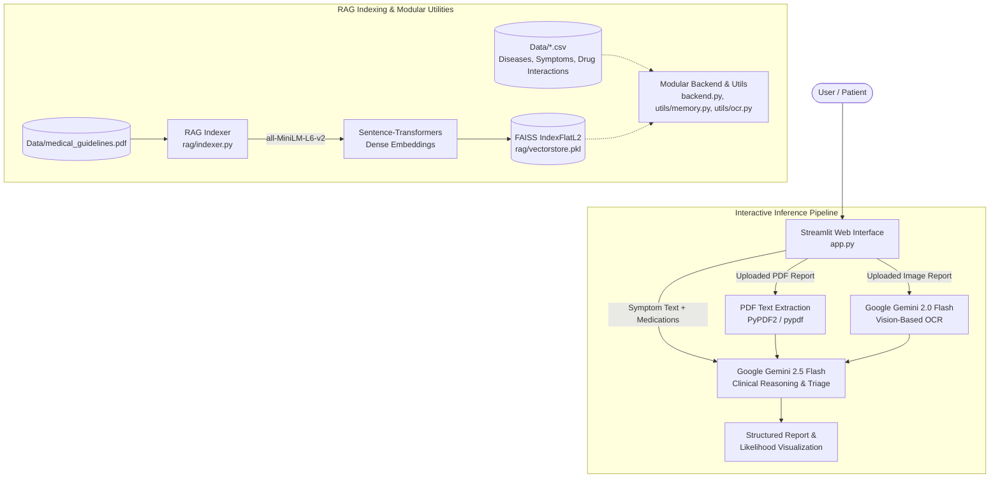

# DiagnoSense: AI-Powered Healthcare Assistant

**DiagnoSense** is an end-to-end multimodal generative AI application designed for preliminary symptom triage and automated clinical document interpretation. Built in Python with Streamlit, Google Gemini foundation models, and a FAISS-backed Retrieval-Augmented Generation (RAG) indexing pipeline, the project demonstrates applied LLM orchestration, multimodal OCR, dense semantic indexing, and structured healthcare data modeling.

> **Medical Disclaimer:** DiagnoSense is an educational and research prototype intended solely for informational and technical demonstration purposes. It is **not** a certified medical device and does not provide clinical diagnoses, prescriptions, or medical advice. Always consult a qualified healthcare professional for medical decisions.

## Executive Summary

Modern healthcare workflows rely heavily on unstructured clinical narratives—both patient-reported symptom descriptions and multi-format diagnostic reports (PDFs and scanned images). DiagnoSense addresses this challenge through a modular Python architecture that combines:

1. **Dual-Model LLM Routing:** Separates clinical text reasoning (`models/gemini-2.5-flash`) from multimodal vision-based OCR (`models/gemini-2.0-flash`) to process heterogeneous patient inputs efficiently.
2. **Semantic Vector Indexing (RAG Foundation):** Transforms clinical guideline PDFs into dense embeddings using `sentence-transformers` (`all-MiniLM-L6-v2`) and indexes them with Facebook AI Similarity Search (`faiss.IndexFlatL2`) for low-latency retrieval.
3. **Structured Domain Knowledge & Utilities:** Pairs generative inference with curated CSV reference tables (diseases, symptom mappings, and drug-drug interactions), reusable document/OCR utilities, and a stateful conversation memory abstraction.

## Key Capabilities & AI Engineering Highlights

### 1. Natural-Language Symptom Triage (`app.py`, `backend.py`)
* Accepts free-form patient symptom descriptions along with optional current medication context via the Streamlit sidebar.
* Prompts `models/gemini-2.5-flash` to produce structured clinical assessments covering probable conditions, risk stratification, clarifying follow-up questions, and general care guidance.
* Visualizes relative condition likelihoods through custom HTML/CSS animated probability indicators (`show_disease_likelihood`).
* Encapsulates reusable backend inference logic inside the `DiagnoSenseBackend` class (`backend.py`) for decoupled programmatic use.

### 2. Multimodal Medical Report Analysis (`app.py`, `utils/ocr.py`, `utils/pdf_utils.py`)
* **PDF Ingestion:** Extracts multi-page clinical text from uploaded PDF reports (`PyPDF2.PdfReader` in `app.py`; `pypdf.PdfReader` in `utils/pdf_utils.py`).
* **Vision-LLM & Classical OCR:** Converts uploaded `JPG`, `JPEG`, and `PNG` medical reports into PNG byte streams for multimodal text extraction via `models/gemini-2.0-flash`, complemented by a local Tesseract OCR module (`utils/ocr.py` using `pytesseract` and `Pillow`).
* **Automated Clinical Summarization:** Passes extracted report content to `models/gemini-2.5-flash` to identify key findings, highlight potential abnormalities, and surface urgent-care indicators.

### 3. Dense Retrieval-Augmented Generation (RAG) Indexing (`rag/indexer.py`)
* Parses `Data/medical_guidelines.pdf` using `pypdf` and segments content into paragraph-level text chunks (`\n\n` delimiters).
* Generates dense vector representations via `SentenceTransformer("all-MiniLM-L6-v2")`.
* Constructs a Euclidean similarity index (`faiss.IndexFlatL2`) and persists both the vector index and text corpus to `rag/vectorstore.pkl` for reproducible downstream retrieval.

### 4. Modular Supporting Components
* **Conversation State (`utils/memory.py`):** Implements `ConversationMemory` to track multi-turn user and assistant message history.
* **Model Discovery Utility (`check_models.py`):** Queries `google.generativeai.list_models()` to verify API credentials and inspect available Gemini model endpoints in the active environment.

## System Architecture



## Technology Stack

| Layer | Technology / Library | Role in Project |
| :--- | :--- | :--- |
| **Language** | Python 3.9+ | Core application, backend, and ML/RAG scripting |
| **Frontend UI** | Streamlit (`1.33.0`) | Wide-layout interactive web interface and file upload workflow |
| **Generative AI (Text)** | Google Gemini (`models/gemini-2.5-flash`) | Symptom triage, clinical summarization, and structured guidance |
| **Generative AI (Vision)** | Google Gemini (`models/gemini-2.0-flash`) | Multimodal OCR on uploaded medical report images |
| **Embeddings** | Sentence-Transformers (`2.5.1`, `all-MiniLM-L6-v2`) | Dense semantic encoding of medical guideline chunks |
| **Vector Search** | FAISS (`faiss-cpu==1.7.4`, `IndexFlatL2`) | L2 nearest-neighbor vector indexing and persistence (`vectorstore.pkl`) |
| **Document & OCR Parsing** | `pypdf` (`4.2.0`), `PyPDF2`, `pytesseract` (`0.3.10`), `Pillow` (`10.3.0`) | PDF text extraction and image preprocessing / fallback OCR |
| **Data Processing** | `pandas` (`2.2.2`), `numpy` (`1.26.4`) | Tabular reference datasets and numerical array operations |
| **Configuration** | `python-dotenv` (`1.0.1`) | Environment variable management for `GOOGLE_API_KEY` |

## Repository Structure

```text
AI-Powered-Healthcare-Assistant/
├── app.py                      # Main Streamlit application (Symptom & Medical Report Analyzers)
├── backend.py                  # Standalone DiagnoSenseBackend class wrapping Gemini 2.5 Flash
├── check_models.py             # Utility script to enumerate accessible Google Generative AI models
├── requirements.txt            # Core Python dependency manifest
├── LICENSE                     # MIT License
├── README.md                   # Project documentation
├── Data/                       # Curated domain datasets and clinical reference documents
│   ├── diseases.csv            # Disease descriptions (7 reference conditions)
│   ├── drugs_interactions.csv  # Known drug-drug interaction pairs (5 reference pairs)
│   ├── symptoms_dataset.csv    # Symptom-to-disease mapping records (10 mappings)
│   └── medical_guidelines.pdf  # Source clinical document indexed by the RAG pipeline
├── rag/                        # Retrieval-Augmented Generation indexing assets
│   ├── indexer.py              # PDF chunking, MiniLM embedding, and FAISS index builder
│   └── vectorstore.pkl         # Serialized FAISS index and text chunks
├── utils/                      # Reusable helper modules
│   ├── memory.py               # ConversationMemory class for multi-turn state tracking
│   ├── ocr.py                  # Local Tesseract OCR helper (PIL + pytesseract)
│   ├── pdf_utils.py            # PDF text extraction helper (pypdf)
│   └── preprocess.py           # Reserved preprocessing module placeholder
└── models/                     # Package namespace reserved for local ML model artifacts
    └── __init__.py
```

## Data & Knowledge Assets

The `Data/` directory provides lightweight, structured reference assets designed for prototyping clinical knowledge grounding and drug-safety checks:

| File | Schema | Scope |
| :--- | :--- | :--- |
| `Data/diseases.csv` | `disease, description` | Reference descriptions for 7 common conditions (Flu, Migraine, Anemia, Heart Disease, Asthma, Food Poisoning, Diabetes) |
| `Data/symptoms_dataset.csv` | `symptom, disease` | 10 structured symptom-to-disease mapping records |
| `Data/drugs_interactions.csv` | `drug1, drug2, interaction` | 5 clinically relevant drug-interaction pairs (e.g., Aspirin + Warfarin, Metformin + Insulin) |
| `Data/medical_guidelines.pdf` | Unstructured PDF | Source medical guideline text embedded into `rag/vectorstore.pkl` |

## Installation & Local Setup

### Prerequisites
* Python 3.9 or higher
* A valid Google AI Studio API key (`GOOGLE_API_KEY`)
* *(Optional)* Tesseract OCR system binary if using the local `utils/ocr.py` utility

### 1. Clone the Repository
```bash
git clone https://github.com/Pranay890/AI-Powered-Healthcare-Assistant.git
cd AI-Powered-Healthcare-Assistant
```

### 2. Create and Activate a Virtual Environment
```bash
python -m venv venv
# Windows
venv\Scripts\activate
# macOS / Linux
source venv/bin/activate
```

### 3. Install Dependencies
```bash
pip install -r requirements.txt
pip install google-generativeai PyPDF2
```
> **Note:** `google-generativeai` and `PyPDF2` are imported directly by `app.py`, `backend.py`, and `check_models.py` and should be installed alongside `requirements.txt` (see the Engineering Roadmap below for dependency consolidation).

### 4. Configure Environment Variables
Create a `.env` file in the project root:
```env
GOOGLE_API_KEY=your_google_gemini_api_key_here
```

### 5. Verify Model Access (Optional)
```bash
python check_models.py
```

### 6. Rebuild the FAISS Vector Index (Optional)
A pre-built index is included at `rag/vectorstore.pkl`. To regenerate it from `Data/medical_guidelines.pdf`:
```bash
python -c "from rag.indexer import build_index; build_index('Data/medical_guidelines.pdf')"
```

### 7. Launch the Application
```bash
streamlit run app.py
```
The interface will open automatically at `http://localhost:8501`.

## Usage Workflow

1. **Configure Medication Context (Optional):** Enter active medications in the left sidebar (`Settings` -> `Current Medications`) so symptom guidance can account for concurrent therapies.
2. **Symptoms Analyzer:** Enter a natural-language description of symptoms (duration, severity, accompanying signs) to receive a structured Gemini 2.5 Flash assessment and visual likelihood breakdown.
3. **Medical Report Analyzer:** Upload a diagnostic report in `PDF`, `JPG`, `JPEG`, or `PNG` format. The application automatically routes PDFs through text extraction and images through Gemini 2.0 Flash vision OCR before generating a structured clinical summary.

## Current Limitations & Engineering Roadmap

Maintaining transparent documentation of architectural boundaries is a core part of production AI engineering. The following areas are scoped for the next iteration of DiagnoSense:

* **End-to-End RAG & Memory Wiring:** Connect `rag/vectorstore.pkl`, `backend.py`, `Data/drugs_interactions.csv`, and `utils/memory.py` directly into `app.py` (which currently runs as a self-contained Streamlit script) so every query retrieves top-k clinical chunks and performs deterministic drug-interaction checks.
* **Dynamic Likelihood Scoring:** Replace the illustrative placeholder probability values (`dummy_symptom_probs`) in the symptom likelihood visualization with structured JSON outputs parsed directly from Gemini responses.
* **Dependency & Path Normalization:** Add `google-generativeai` to `requirements.txt`, standardize PDF parsing on `pypdf` (removing redundant `PyPDF2` and unused `openai` references), and align the default `data/` path casing in `rag/indexer.py` with the repository's `Data/` directory.
* **Evaluation & Guardrails:** Introduce automated prompt-evaluation test cases, input validation, and structured citation rendering for retrieved clinical guidelines.

## License & Author

This project is released under the **MIT License** — see the [LICENSE](https://www.google.com/search?q=https://github.com/Pranay890/AI-Powered-Healthcare-Assistant/blob/main/LICENSE) file for details.

* **Author:** [Pranay890](https://github.com/Pranay890)
* **Repository:** [AI-Powered-Healthcare-Assistant](https://github.com/Pranay890/AI-Powered-Healthcare-Assistant)